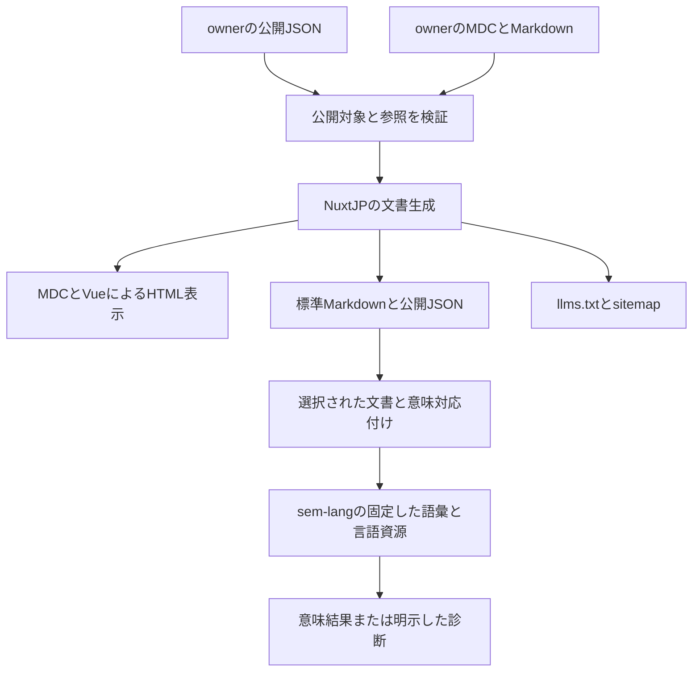

# NuxtJPの公開文書とsem-lang連携方針

2026年10月28日更新。NuxtJPは、公開JSONとMarkdownから、人向けHTMLと
エージェント向けMarkdownを同じ公開条件で生成する共通実装を担当する。
sem-langは文書の意味と語彙の解決を担当し、Zixcelは汎用の構造解析を担当する。
各製品・サイトownerは原文、主張、公開範囲、正式版と配備を所有する。

本書は実装の責務と受入条件を定める。MDCによる表示と静的Markdown・llms.txt生成は
0.4.0のsource candidateに実装した。[編集・生成手順](markdown-mdc.ja.md)を参照。
正式なpackage公開とconsumerの依存更新・配備、Nuxt Content固有の連携、意味対応付けは
それぞれ別の受入であり、実施済みとは扱わない。
既存リポジトリ名・package名・schema識別子を維持し、リポジトリの移動や統合は行わない。

## 管理対象の整理

管理対象は作業環境で管理している12のGitHub ownerを基準とする。ownerは
GitHub Organizationと個人アカウントを区別する。例えば`coela-oss`はUserであり、
組織用APIの失敗を、リポジトリやサービスの不存在とは扱わない。
アクセス可能な全アカウントの所属一覧や、稼働サービス一覧とは別の範囲である。

| owner | この構成で担当すること |
| --- | --- |
| nuxtjp | Nuxtでの編集・表示・静的生成、Markdown配信、公開文書の発見性 |
| semantic-language | 文書構造に対する意味の対応、TermId、言語資源、診断 |
| zixcel | 形式に依存しない文書構造、Markdown・HTML・JSONの形式アダプター、provider観測 |
| crowsi-net | 通信、資格情報、実行時の境界。文書の意味や公開の判断は製品ownerが担う |
| hat-inc | 法人の公開内容、サービスの公開名、問い合わせ・稼働情報の提供条件 |
| hathq | HATの製品・仕様・配布条件。閲覧、取得、信頼、導入、実行を区別する |
| neo-erp | 業務・個人向け製品の情報と、製品側で判断した公開内容 |
| tparty | 判断材料、解釈、根拠、意思決定の製品側での対応付け |
| constillo | 比較可能な計画と制約、その説明と利用例 |
| vpremises | 環境の構成・構築・運用に関する原文と実際の受入情報 |
| incusjp | 日本語の導入案内、独自連携と上流Incusの区分 |
| coela-oss | 設計指針・教材の原文と個人ポートフォリオ。公開済み資料の参照・集約 |

組織横断の私的な棚卸しと、サイトに掲載する公開一覧は分ける。公開リポジトリで
あっても自動的に配備対象にはしない。非公開製品はownerが登録した公開名と公開説明
だけを使用し、内部リポジトリ名、運用台帳、認証情報を文書へ出力しない。

## NuxtJP内のリポジトリ分担

| リポジトリ | 担当 | この構成での位置付け |
| --- | --- | --- |
| nuxtjp/site-builder | @nuxtjp/localized-site | 公開文書の統合、日英ルート、HTML・Markdown・索引の生成と公開条件の検証 |
| nuxtjp/website | nuxt.jpの内容と配備 | 最初の実consumer。Nuxt公式の案内とNuxtJP独自機能を区別する |
| nuxtjp/nuxtjp-ui | 共通UI、テーマ、言語表示 | 文書の表示部品。意味解析や製品の認可は所有しない |
| nuxtjp/declarative-ui | 宣言された画面とinteraction表示 | 宣言UIを使うconsumerで選択する。静的文書の必須依存にはしない |
| nuxtjp/flow | グラフ表示のNuxt連携 | 図の表示を担当し、同じ情報をテキストにも出力する |
| nuxtjp/nuxt-local-runtime | ローカルruntimeへの接続 | ローカル製品での任意連携。公開文書の閲覧には不要 |
| nuxtjp/nuxt-v8-view-worker | 制限された表示生成 | 既存の動的表示用途を維持。Markdown配信のためには追加しない |
| nuxtjp/nuxt-interaction-fixture | interactionの統合検証 | 実際の操作を伴うconsumerの検証に使い、文書閲覧とは分離する |
| nuxtjp/nuxt-provider-auth | 外部サービス認証の表示 | アプリが選んだ認証フローを表示する。公開文書に認証を要求しない |
| nuxtjp/nuxt-identity-client | identity関連の画面 | 認証が必要な製品画面で使用する |
| nuxtjp/nuxt-commerce | 決済・利用権の表示と引き継ぎ | 製品の商取引のconsumerで使用する |
| nuxtjp/contact-form | 問い合わせUIと受信側の境界 | 公開説明と実送信の受入を分離する |
| nuxtjp/nuxt-vuetify-layer | Vuetify連携 | 既存consumerの選択肢を維持し、文書のための必須UI基盤にはしない |

共通機能の追加先はまず`site-builder`内とする。独立した利用者と安定した契約が
必要になるまでは新しいNuxtJPリポジトリや文書schemaを作らない。MDCは公式parserと
MDCRendererを使う。MDX・JSXのcompilerや互換層は追加しない。
Nuxt Contentやnuxt-llmsを採用するconsumerは出力先と公開対象を統合して受け入れる。

## 原文と出力の構成

名称、公開版、互換性、URL、提供状態などの事実はownerの公開JSONを原典とする。
背景、用途、制約、導入手順の編集本文はownerのMDCを原典とする。今回の13か所の
ページ本文JSONは444件すべてMDCへ移し、旧入力と旧本文rendererを削除した。
標準構成の公開JSONは、検証済みデータからMDCを生成する。同じ文章を手修正で複製しない。

今回のページ表示にはMDCとVueを使う。製品カード、表、タブ、グラフには標準Markdownでの
表現を用意し、重要な値、コード、制約、リンクを出力する。未対応の部品で重要な本文が
消える場合は生成を失敗させる。JSONの文字列をJavaScriptやMDCの実行可能な式として
解釈せず、値と信頼された表示部品を分ける。

HTMLとMarkdownの二つの本文を後から相互変換して同期する方式は採らない。
同じ確定した入力から両方を生成し、既存のNuxt ContentのASTやZixcelの構造契約を
用途に応じて使う。両者を同一schemaと仮定せず、必要な対応付けだけを所有者の
アダプターとして実装する。

## 既存の構造解析との境界

[zixcel/document-processing](https://github.com/zixcel/document-processing)の
`@zixcel/document-structure`は汎用の構造契約、`@zixcel/document-markdown`は
CommonMarkの構造解析、`@zixcel/document-html`はHTMLの構造解析を所有する。
現在のMarkdown解析は埋め込みHTMLをopaqueとして保持し、入力上限による
`truncated`も表現する。これを「全文を意味理解した」とは扱わない。
NuxtJPに第二の汎用解析器を作らない。

MDCの構造解析とNuxtでの表示はVue・Nuxtの表示側の責務であり、ZixcelのCommonMark
解析器に表示形式の実行を追加しない。表示部品を標準Markdownへ展開してから、必要な
構造検証へ渡す。表などCommonMark以外の記法の対応は選択したparserで確認する。

`zixcel/data-presentation`のsnapshot実行基盤は、既に動的projectionを使う製品の
選択肢とする。静的文書に常駐producer、認証サーバー、永続storeを追加しない。
公開JSONや文書への参照は、外部ネットワークを取得する命令として実行しない。

## sem-langとの対応

[sem-langの文書解析](https://github.com/semantic-language/sem-lang/blob/04b4ddc2e3c75df5af6651dd37915f8e90539c8d/crates/sem-lang-vocab/src/document.rs)
は、見出し、プロパティ、順序付きリスト、引用、コード、表、段落などを原文と行位置を
保持して扱う。表示構造の解析自体は、見出しの語に意味を割り当てない。
Markdownを読めることと、意味が確定したことを区別する。

| 文書で表す役割 | 既存の標準語彙 | 対応で守ること |
| --- | --- | --- |
| 目的 | DocumentPurpose | 説明文と、達成したという判定を分ける |
| 対象 | DocumentTarget | 表示名だけでなく明示した参照先で識別する |
| 完了条件 | CompletionCriteria | 条件を記述し、完了したと自動判定しない |
| 根拠 | EvidenceReference | 根拠の参照先、対象版、取得時点を保持する |
| 手順 | OrderedSteps | 順序を保持し、表示順やJSON配列の位置から意味を推測しない |

この表は文書の役割を選ぶための対応表であり、日本語や英語の見出しから任意の
TermIdを自動生成する規則ではない。実際のTermId、語彙版、compiled language、
locale、解釈contextはsem-lang側で選択する。日本語と英語は同じ意味IDに対応付け、
翻訳、表示ラベル、ページslugと意味IDを分離する。

一般の記事は一般のMarkdownとして公開できる。意味を機械検証する部分だけを、
選択された`.sem`文書または明示した対応付けとしてsem-langへ渡す。
frontmatter、MDC、任意のHTML、JavaScriptをsem-langがそのまま意味理解するとは扱わない。
対応付けできない箇所、曖昧な語、欠けたcontextは診断として残す。

sem-langの現在の`source_to_structural`は、汎用JSONの配列とi64に収まらない数値を
拒否する。公開JSON全体を直接渡す前提にはしない。選択したrecordの対応付けを先に
受け入れ、順序付きデータや小数への対応は意味owner側で別に定義・検証する。
文書をJSONにしてMarkdownへ戻す往復で、原文や診断位置を復元できると主張しない。

文書ID、locale、原文revision、出力digest、元ファイルと範囲の対応を残す。
翻訳・部品展開後の範囲は元の範囲と別に記録する。digestは同一性の確認に使い、
発行者の信頼や操作の権限の証明にはしない。

sem-langは現在source-ownedのRust実装であり、npm公開やブラウザー実行を前提にしない。
初期の意味連携は固定sourceを使う別のオフライン検証とし、Nuxtの閲覧時依存にしない。
意味が確定しても、文書中の手順や操作を実行する許可にはならない。

## 公開と配信

公開対象の同じ一覧から、HTML、Markdown、索引、検索用データ、配布されるContent DBを
生成する。非公開文書は生成用の公開selectionから除外し、metadataも公開可能な
項目だけを出力する。llms.txtからの除外だけで直接URLを保護したことにはしない。
既存の`nuxtjp://showcase/v1`はその目的で維持し、任意文書の万能schemaには拡張しない。

source candidateではページ別の静的Markdownとllms.txt、およびHTMLのMarkdown alternateを生成する。Nuxt Contentの`nuxt-llms`連携を
利用する際は、既存consumerの明示したprerender対象と競合しないよう出力先を統合する。
別URLでの出力確認後、`Accept: text/markdown`への形式切替を追加する。Acceptの優先度、
q=0、HEAD、Content-Type、Vary、形式別ETagとキャッシュキーを検証する。
Cloudflareの自動HTML変換を実行時の前提にはしない。

公開文書のGETは外部エージェントにも開く。Origin、User-Agent、Fetch Metadataを
認証として使わない。管理、更新、収集、認証済みデータは内部の認証境界に置く。
稼働情報は取得時点と有効期限を持つ読み取り用データを参照し、期限切れの状態を
静的Markdownで正常稼働として残さない。

## 実装順序と受入

| 段階 | owner | 完了を確認する根拠 |
| --- | --- | --- |
| 1 公開文書の例を固定 | site-builderとwebsite | 日英各1ページ。名称、公開版、導入コード、制約、根拠リンク、表、部品を含む同一入力 |
| 2 HTMLとMarkdownを生成 | site-builder | 重要情報と参照先の一致、決定論的生成、未対応部品の拒否、非公開入力の全出力経路からの除外 |
| 3 意味の対応を受入 | sem-langとsite-builder | 実際の固定sourceで語彙・contextを選択。日英の意味ID、原文範囲、曖昧さ・未対応の診断を確認 |
| 4 NuxtJPサイトで受入 | website | 公開URL、日英ルート、Markdown・索引、キャッシュとHEAD/条件付き要求を実配信で確認 |
| 5 各サイトへ展開 | 各owner | 正式な公開moduleを固定導入し、各サイトの内容・配布物・配備・読戻しを個別に記録 |

NuxtJPとZixcelの境界検証では、既存packageの実exportを使うconsumerで試験する。
対応していないnodeやtruncatedな入力をfixtureで成功扱いしない。汎用解析器と
sem-langの文書解析は、言語が担う役割が違うため一方へ無理に統合しない。

agent-readinessの受入は、対象ページの出力率100%、非公開情報の混入0件、
HTML/Markdownの形式取り違え0件とする。転送量・トークン数・固定質問の正答と
引用先は同条件で比較し、索引やMarkdownを公開しただけで引用増加を達成済みにしない。
Cloudflareの実測は別の読み取り権限と収集周期で扱う。

Issue、実装、公開module、各サイトの配備は各ownerで追跡する。完了済みの過去の
一括配備Issueを再利用せず、新しい中央実行サービスや一括配備権限を追加しない。

## 仕様と設計根拠

- [Nuxt ContentのLLMs連携](https://content.nuxt.com/docs/integrations/llms)
- [Nuxt ContentのMarkdownとMDC](https://content.nuxt.com/docs/files/markdown)
- [sem-langの標準文書語彙](https://github.com/semantic-language/sem-lang/blob/04b4ddc2e3c75df5af6651dd37915f8e90539c8d/crates/sem-lang-standard/definitions/document.sem)
- [sem-langのJSON接続の現在の制約](https://github.com/semantic-language/sem-lang/blob/04b4ddc2e3c75df5af6651dd37915f8e90539c8d/crates/sem-lang-frontend/src/current/source_structure.rs)
- [公開feedの既存の責務](public-showcase.md)
- [site-builderのOSS責務](oss-source-contract.md)

設計レビューにはCoela engineering-principles 0.1.0、content catalog 0.2.4の日本語版を
使用した。指針sourceは`2af18b91fa8ba7aa4e0bd8d586daa388946ea26d`、日本語本文の
SHA256は`13bd69a229106ea3e040c445aae03b2aded3649a04703bda16ae555594110f48`。
責務、明示した権限、根拠と不確実性を評価軸とし、操作の許可としては使用しない。
